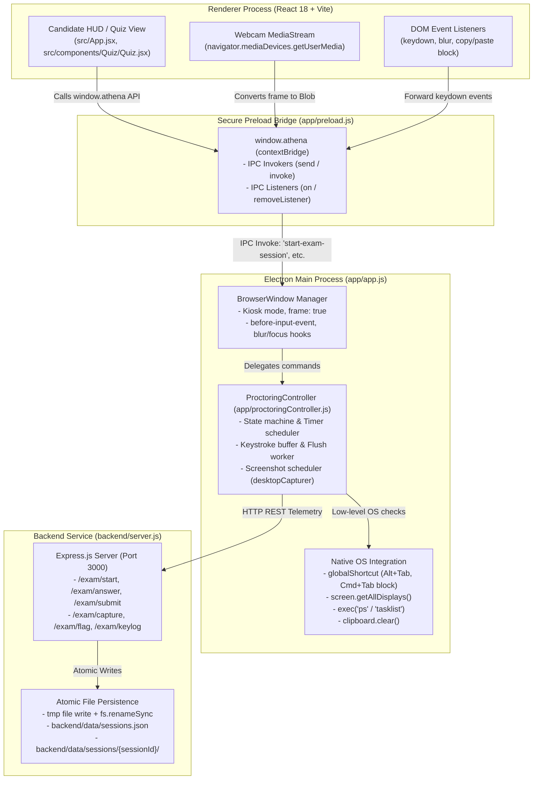
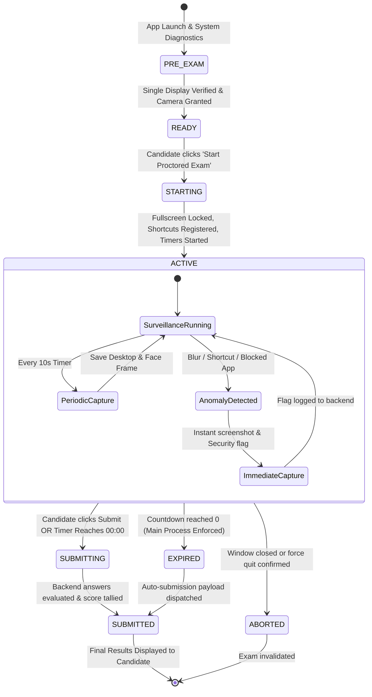
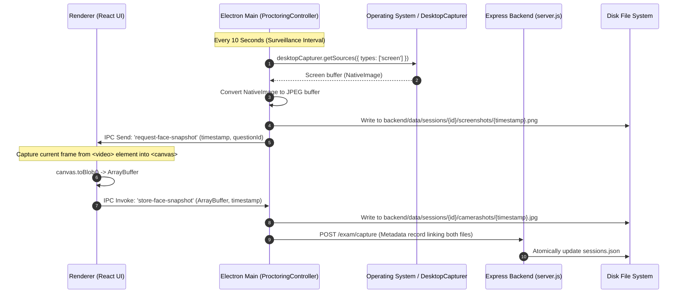

# Proctorly 🛡️ — System Architecture & Technical Reference Guide

> **Comprehensive Technical Reference and High-Level Design (HLD)**  
> An end-to-end breakdown of how each anti-cheat proctoring feature is built, which functions implement them, exact file locations, and architectural design decisions.

---

## 📑 Table of Contents

1. [High-Level Design (HLD) Diagrams](#1-high-level-design-hld-diagrams)
   - [System Context & Process Architecture](#system-context--process-architecture)
   - [Exam Lifecycle State Machine](#exam-lifecycle-state-machine)
   - [Synchronized Surveillance & Telemetry Flow](#synchronized-surveillance--telemetry-flow)
2. [Quick Function & Feature Matrix](#2-quick-function--feature-matrix)
3. [Deep-Dive Feature Implementations & Code Snippets](#3-deep-dive-feature-implementations--code-snippets)
   - [Feature 1: Process Inspector & Prohibited App Blocker](#feature-1-process-inspector--prohibited-app-blocker)
   - [Feature 2: Fullscreen Kiosk Mode & Multi-Display Guard](#feature-2-fullscreen-kiosk-mode--multi-display-guard)
   - [Feature 3: Window Focus / Blur Tracking & Clipboard Eraser](#feature-3-window-focus--blur-tracking--clipboard-eraser)
   - [Feature 4: Low-Level Keyboard Interception & Shortcut Lockout](#feature-4-low-level-keyboard-interception--shortcut-lockout)
   - [Feature 5: High-Frequency Keystroke Telemetry & Buffer Flushing](#feature-5-high-frequency-keystroke-telemetry--buffer-flushing)
   - [Feature 6: Synchronized Desktop & Webcam Surveillance Snapshots](#feature-6-synchronized-desktop--webcam-surveillance-snapshots)
   - [Feature 7: Authoritative Main-Process Clock & Auto-Submission](#feature-7-authoritative-main-process-clock--auto-submission)
   - [Feature 8: Secure Context Bridge & Process Isolation (IPC)](#feature-8-secure-context-bridge--process-isolation-ipc)
   - [Feature 9: Fault-Tolerant Atomic File Storage & Crash Recovery](#feature-9-fault-tolerant-atomic-file-storage--crash-recovery)
   - [Feature 10: Dynamic Student Examination HUD & Violation Banner](#feature-10-dynamic-student-examination-hud--violation-banner)

---

## 1. High-Level Design (HLD) Diagrams

### System Context & Process Architecture

Proctorly employs a **three-tier isolated architecture**:
1. **Renderer Process (React + Vite)**: Renders the exam questions, webcams preview, and alerts. Zero direct access to Node.js or OS APIs.
2. **Preload Script (`contextBridge`)**: Strictly validated sandbox bridge exposing the `window.athena` API.
3. **Main Process (Electron)**: Orchestrates native window bounds, global shortcuts, screen capture, and process inspection.
4. **Backend Daemon (Express.js)**: Spawned via child process (`fork`), handling atomic session logs, assessment evaluation, and media storage.



---

### Exam Lifecycle State Machine



---

### Synchronized Surveillance & Telemetry Flow



---

## 2. Quick Function & Feature Matrix

| Feature | Primary File | Primary Method / Function | Purpose / Mechanism |
| :--- | :--- | :--- | :--- |
| **Prohibited Process Scanner** | [proctoringController.js](file:///Users/patlorinipun/Desktop/Semester_5/AD/Proctorly/app/proctoringController.js#L856-L910) | `static getRunningProcesses()` | Executes `ps -eo comm=` (macOS/Linux) or `tasklist` (Windows) and compares against `BLOCKED_APPS`. |
| **Multi-Display Detection** | [proctoringController.js](file:///Users/patlorinipun/Desktop/Semester_5/AD/Proctorly/app/proctoringController.js#L87-L95) | `checkDisplays()` | Queries `screen.getAllDisplays()` to ensure student is not using HDMI splitters or dual monitors. |
| **Kiosk & Fullscreen Lock** | [app.js](file:///Users/patlorinipun/Desktop/Semester_5/AD/Proctorly/app/app.js#L149-L165) | `ipcMain.handle('enter-fullscreen')` | Sets `win.setFullScreen(true)` and enforces fullscreen boundaries. |
| **Window Blur & Focus Tracker** | [app.js](file:///Users/patlorinipun/Desktop/Semester_5/AD/Proctorly/app/app.js#L104-L111) | `electronWindow.on('blur')` | Emits `handleFocusLost()`, clears the OS clipboard, and flags violation. |
| **Anti-Shortcut Interceptor** | [app.js](file:///Users/patlorinipun/Desktop/Semester_5/AD/Proctorly/app/app.js#L86-L96) | `webContents.on('before-input-event')` | Intercepts keyboard events before DOM ingestion; blocks Ctrl+C, Ctrl+V, Alt+Tab, etc. |
| **Global Shortcut Trap** | [proctoringController.js](file:///Users/patlorinipun/Desktop/Semester_5/AD/Proctorly/app/proctoringController.js#L486-L528) | `registerGlobalShortcuts()` | Uses `globalShortcut.register()` to intercept system hotkeys (Cmd+Tab, Spotlight, Mission Control). |
| **Periodic Surveillance** | [proctoringController.js](file:///Users/patlorinipun/Desktop/Semester_5/AD/Proctorly/app/proctoringController.js#L273-L290) | `triggerSynchronizedCapture()` | Captures desktop screen via `desktopCapturer` and requests matching webcam snapshot from renderer. |
| **Keystroke Telemetry Logger** | [proctoringController.js](file:///Users/patlorinipun/Desktop/Semester_5/AD/Proctorly/app/proctoringController.js#L708-L798) | `recordKeylog()` & `flushKeylogs()` | Buffers keypress metadata in RAM and flushes to `keylogs.json` and `keylogs.jsonl`. |
| **Authoritative Exam Timer** | [proctoringController.js](file:///Users/patlorinipun/Desktop/Semester_5/AD/Proctorly/app/proctoringController.js#L419-L453) | `startClockTimer()` | 1-second interval driven by Main Process; sends `timer-tick` event to renderer; auto-submits on 0. |
| **Secure IPC Isolation** | [preload.js](file:///Users/patlorinipun/Desktop/Semester_5/AD/Proctorly/app/preload.js#L3-L65) | `contextBridge.exposeInMainWorld()` | Grants renderer selective, safe access to electron IPC while disabling Node integration. |
| **Atomic Session Persistence** | [server.js](file:///Users/patlorinipun/Desktop/Semester_5/AD/Proctorly/backend/server.js#L40-L52) | `saveSessions()` | Writes to temporary file (`.tmp`) and renames synchronously to guarantee zero data corruption. |
| **Candidate Exam Dashboard** | [App.jsx](file:///Users/patlorinipun/Desktop/Semester_5/AD/Proctorly/src/App.jsx#L20-L852) | `App()` | Coordinates student verification, question navigation, timer HUD, and violation warnings. |

---

## 3. Deep-Dive Feature Implementations & Code Snippets

---

### Feature 1: Process Inspector & Prohibited App Blocker

#### 🎯 Problem & Threat Model
Students taking an online exam may run screen-sharing software (Zoom, TeamViewer, AnyDesk), communication apps (Discord, Slack, WhatsApp), or screen recorders (OBS Studio) to transmit exam questions or receive external assistance.

#### 💡 Architectural Solution
Proctorly inspects the OS process table before and during the exam. On macOS/Linux, it executes `ps -eo comm=`; on Windows, it executes `tasklist /FO CSV /NH`. The resulting processes are cross-referenced in real-time against `BLOCKED_APPS`.

#### 📍 Exact Location
- **File**: [`app/proctoringController.js`](file:///Users/patlorinipun/Desktop/Semester_5/AD/Proctorly/app/proctoringController.js#L856-L910)
- **Method**: `static getRunningProcesses()`
- **Frontend Hook**: [`src/App.jsx`](file:///Users/patlorinipun/Desktop/Semester_5/AD/Proctorly/src/App.jsx#L60-L75) (`checkApps()`)

#### 💻 Code Snippet
```javascript
// app/proctoringController.js (Lines 856-905)
static getRunningProcesses() {
    return new Promise((resolve) => {
        const isWin = process.platform === 'win32';
        const cmd = isWin ? 'tasklist /FO CSV /NH' : 'ps -eo comm=';

        exec(cmd, { timeout: 3000 }, (err, stdout) => {
            if (err || !stdout) {
                return resolve({ runningProcesses: [], blockedApps: [] });
            }

            const lines = stdout.toLowerCase().split('\n');
            const detectedBlocked = new Set();

            for (const target of BLOCKED_APPS) {
                for (const line of lines) {
                    if (line.includes(target)) {
                        detectedBlocked.add(target);
                        break;
                    }
                }
            }

            resolve({
                runningProcesses: Array.from(detectedBlocked),
                blockedApps: Array.from(detectedBlocked)
            });
        });
    });
}
```

---

### Feature 2: Fullscreen Kiosk Mode & Multi-Display Guard

#### 🎯 Problem & Threat Model
Students can connect external monitors, projectors, or side-car screens to view answers on one monitor while keeping the exam active on another. On macOS, trackpad gestures (e.g. 3-finger swipe up for Mission Control or 3-finger swipe left/right between Spaces) allow users to slide the exam window aside and view background applications (browser windows, chat apps) without closing the exam window.

#### 💡 Architectural Solution
1. **Multi-Display Check**: `checkDisplays()` queries Electron's `screen.getAllDisplays()`. If `displays.length > 1`, the system detects an external display and denies exam start.
2. **Native Kiosk Mode**: Electron's `win.setKiosk(true)` engages macOS system presentation options (`NSApplicationPresentationDisableProcessSwitching`). This programmatically suppresses Mission Control gestures, Spaces switching, the Dock, and the Menu Bar.
3. **Screen-Saver Level Priority**: `win.setAlwaysOnTop(true, 'screen-saver', 1)` elevates the window to native `NSScreenSaverWindowLevel`, preventing any notifications or background windows from rendering in front of the exam.
4. **Transition Mutex Lock**: Fullscreen and kiosk transitions use an `isTransitioningFullscreen` mutex guard (1200ms debounce) to prevent concurrent AppKit window mutations that could trigger `NSThemeFrame.m:5523` `SIGABRT` crashes.
5. **Dual State Validation & Exit Hook**: When the student exits fullscreen/kiosk, `handleFullscreenExited()` fires, triggering an immediate desktop snapshot and locking the exam HUD until restored.

#### 📍 Exact Location
- **Display Check**: [`app/proctoringController.js`](file:///Users/patlorinipun/Desktop/Semester_5/AD/Proctorly/app/proctoringController.js#L87-L95)
- **Kiosk Entry / Exit**: [`app/proctoringController.js`](file:///Users/patlorinipun/Desktop/Semester_5/AD/Proctorly/app/proctoringController.js#L102-L148) (`enterExamFullscreen()`, `exitExamFullscreen()`)
- **Fullscreen Event Handler**: [`app/proctoringController.js`](file:///Users/patlorinipun/Desktop/Semester_5/AD/Proctorly/app/proctoringController.js#L644-L675) (`handleFullscreenExited()`)
- **IPC Invocations**: [`app/app.js`](file:///Users/patlorinipun/Desktop/Semester_5/AD/Proctorly/app/app.js#L213-L245)

#### 💻 Code Snippet
```javascript
// app/proctoringController.js
enterExamFullscreen() {
    if (!this.window || this.window.isDestroyed()) return;
    if (this.window.isKiosk() && this.window.isFullScreen()) return;
    if (this.isTransitioningFullscreen) return;

    this.isTransitioningFullscreen = true;
    try {
        this.window.setFullScreenable(true);
        this.window.setAlwaysOnTop(true, 'screen-saver', 1);
        this.window.setKiosk(true);
        this.window.focus();
    } catch (err) {
        console.warn('Failed to enter kiosk mode:', err);
    } finally {
        setTimeout(() => {
            this.isTransitioningFullscreen = false;
        }, 1200);
    }
}
```

---

### Feature 3: Window Focus / Blur Tracking & Clipboard Eraser

#### 🎯 Problem & Threat Model
A student may use Alt+Tab or mouse clicks to switch to an application behind the exam window or attempt to copy content from the exam or paste external answers.

#### 💡 Architectural Solution
1. **Blur Detection**: Native window `blur` listener detects when the Electron window loses OS focus.
2. **Immediate Evidence Capture**: Triggers `captureImmediate('WINDOW_BLUR')` to capture whatever window the user switched to.
3. **Clipboard Eradication**: A 2-second interval in `app.js` runs `clipboard.clear()`, wiping the candidate's clipboard buffer continuously during `EXAM_STATES.ACTIVE`.

#### 📍 Exact Location
- **Window Hook**: [`app/app.js`](file:///Users/patlorinipun/Desktop/Semester_5/AD/Proctorly/app/app.js#L104-L111) & [Lines 130-138](file:///Users/patlorinipun/Desktop/Semester_5/AD/Proctorly/app/app.js#L130-L138)
- **Controller Logic**: [`app/proctoringController.js`](file:///Users/patlorinipun/Desktop/Semester_5/AD/Proctorly/app/proctoringController.js#L565-L605) (`handleFocusLost()`)

#### 💻 Code Snippet
```javascript
// app/proctoringController.js (Lines 565-595)
async handleFocusLost() {
    if (this.state !== EXAM_STATES.ACTIVE) return;

    try {
        clipboard.clear(); // Immediately wipe OS clipboard
    } catch {}

    this.logEvent('WINDOW_FOCUS_LOST', this.currentQuestionId, {
        details: 'Window focus lost (possible application switch)'
    });

    if (this.session?.mode === 'PROCTORED') {
        await this.flagBackend('WINDOW_FOCUS_LOST', 'Window focus lost', this.currentQuestionId);
        await this.captureImmediate('WINDOW_FOCUS_LOST');
    }

    if (this.window && !this.window.isDestroyed()) {
        this.window.webContents.send('window-focus-lost');
    }
}
```

---

### Feature 4: Low-Level Keyboard Interception & Shortcut Lockout

#### 🎯 Problem & Threat Model
Students can trigger OS shortcuts (Cmd+Tab, Alt+Tab, Ctrl+C, Ctrl+V, PrintScreen, Spotlight search, Developer Tools) to copy questions, search answers, or switch windows.

#### 💡 Architectural Solution
Proctorly uses **two levels of keyboard interception**:
1. **Main Process `before-input-event`**: Intercepts keyboard input at the Chromium engine level *before* it reaches the renderer's DOM tree. It uses **strict boolean modifier set matching** (`reqCtrl === hasCtrl && reqMeta === hasMeta && reqAlt === hasAlt && reqShift === hasShift`) so that regular keystrokes (such as typing numbers or letters) are never falsely flagged, while forbidden shortcuts (Ctrl+C, Cmd+P, F12) trigger `event.preventDefault()` immediately.
2. **OS `globalShortcut`**: Selectively registers OS shortcuts (Cmd+Space, Cmd+H, Cmd+M) to suppress desktop-level controls without conflicting with native OS screenshot handlers.

#### 📍 Exact Location
- **Engine Interceptor**: [`app/app.js`](file:///Users/patlorinipun/Desktop/Semester_5/AD/Proctorly/app/app.js#L130-L140) (`before-input-event`)
- **Controller Decision Logic**: [`app/proctoringController.js`](file:///Users/patlorinipun/Desktop/Semester_5/AD/Proctorly/app/proctoringController.js#L680-L728) (`handleInputEvent()`, `isBlockedInput()`)
- **Global Shortcut Registry**: [`app/proctoringController.js`](file:///Users/patlorinipun/Desktop/Semester_5/AD/Proctorly/app/proctoringController.js#L535-L575) (`registerGlobalShortcuts()`)

#### 💻 Code Snippet
```javascript
// app/proctoringController.js
isBlockedInput(input) {
    if (!input || !input.key) return false;
    const keyLower = input.key.toLowerCase();
    return BLOCKED_KEYS.some(combo => {
        if (!combo.key || combo.key.toLowerCase() !== keyLower) return false;

        const reqCtrl = !!combo.ctrl;
        const reqMeta = !!combo.meta;
        const reqAlt = !!combo.alt;
        const reqShift = !!combo.shift;

        const hasCtrl = !!input.control;
        const hasMeta = !!input.meta;
        const hasAlt = !!input.alt;
        const hasShift = !!input.shift;

        return (
            reqCtrl === hasCtrl &&
            reqMeta === hasMeta &&
            reqAlt === hasAlt &&
            reqShift === hasShift
        );
    });
}
```

---

### Feature 5: High-Frequency Keystroke Telemetry & Buffer Flushing

#### 🎯 Problem & Threat Model
Proctoring forensics require auditing candidate typing behavior. However, writing every single keystroke to disk or sending HTTP requests on every keypress causes massive I/O bottlenecks and freezes the UI.

#### 💡 Architectural Solution
Proctorly implements an in-memory **Keystroke Ring Buffer**:
- Every keypress is pushed to `this.keylogBuffer`.
- A dedicated timer flushes the buffer to disk asynchronously every 5 seconds or whenever the buffer reaches 50 events.
- Writes are persisted to both `keylogs.json` (for bulk inspection) and `keylogs.jsonl` (append-only stream for forensic timeline reconstruction).

#### 📍 Exact Location
- **Buffer & Recording**: [`app/proctoringController.js`](file:///Users/patlorinipun/Desktop/Semester_5/AD/Proctorly/app/proctoringController.js#L708-L748) (`recordKeylog()`)
- **Worker Flush**: [`app/proctoringController.js`](file:///Users/patlorinipun/Desktop/Semester_5/AD/Proctorly/app/proctoringController.js#L750-L798) (`flushKeylogs()`)

#### 💻 Code Snippet
```javascript
// app/proctoringController.js (Lines 750-785)
flushKeylogs() {
    if (this.keylogBuffer.length === 0 || !this.session) return;

    const sessionDir = this.getSessionDir();
    if (!sessionDir) return;

    const entriesToFlush = [...this.keylogBuffer];
    this.keylogBuffer = []; // Clear in-memory buffer

    const jsonlPath = path.join(sessionDir, 'keylogs.jsonl');
    const lines = entriesToFlush.map(e => JSON.stringify(e)).join('\n') + '\n';
    fs.appendFile(jsonlPath, lines, 'utf-8', (err) => {
        if (err) console.error('Failed to append keylogs.jsonl:', err);
    });
}
```

---

### Feature 6: Synchronized Desktop & Webcam Surveillance Snapshots

#### 🎯 Problem & Threat Model
Offline video recording consumes gigabytes of storage and bandwidth. Periodic independent snapshots often suffer from timestamp drift, making it difficult to prove that a candidate looking away from their screen matched a specific illicit window on their desktop.

#### 💡 Architectural Solution
Proctorly uses **synchronized dual-capture**:
1. **Surveillance Loop**: A 10-second interval in `ProctoringController` generates a unified timestamp (e.g., `2026-10-01T03-14-52-510Z`).
2. **Desktop Capture**: Uses Electron's `desktopCapturer.getSources({ types: ['screen'] })` to capture the physical screen to JPEG.
3. **Webcam Capture**: Sends an IPC event `request-face-snapshot` containing that exact timestamp to the renderer. The React frontend grabs the active `<video>` frame into a `<canvas>`, exports an ArrayBuffer, and sends it back to be written to disk with the same timestamp.

#### 📍 Exact Location
- **Surveillance Dispatcher**: [`app/proctoringController.js`](file:///Users/patlorinipun/Desktop/Semester_5/AD/Proctorly/app/proctoringController.js#L273-L365) (`triggerSynchronizedCapture()`, `captureDesktop()`)
- **Webcam Handler in React**: [`src/App.jsx`](file:///Users/patlorinipun/Desktop/Semester_5/AD/Proctorly/src/App.jsx#L221-L248) (`onRequestFaceSnapshot`)
- **Backend Sync Endpoint**: [`backend/server.js`](file:///Users/patlorinipun/Desktop/Semester_5/AD/Proctorly/backend/server.js#L460-L496) (`/exam/capture`)

#### 💻 Code Snippet
```javascript
// src/App.jsx (Lines 221-245) - Frame extraction in Renderer
const removeFaceSnapshotListener = window.athena.onRequestFaceSnapshot(async ({ timestamp }) => {
  if (examState !== 'ACTIVE' || !videoRef.current) return;
  
  const video = videoRef.current;
  const canvas = document.createElement('canvas');
  canvas.width = video.videoWidth || 640;
  canvas.height = video.videoHeight || 480;
  
  const ctx = canvas.getContext('2d');
  ctx.drawImage(video, 0, 0, canvas.width, canvas.height);
  
  canvas.toBlob(async (blob) => {
    if (blob) {
      const buffer = await blob.arrayBuffer();
      // Send binary frame to Main Process with matching timestamp
      window.athena.storeFaceSnapshot(buffer, timestamp);
    }
  }, 'image/jpeg', 0.85);
});
```

---

### Feature 7: Authoritative Main-Process Clock & Auto-Submission

#### 🎯 Problem & Threat Model
Client-side timers implemented in React via `setInterval` suffer from browser throttling (when windows are in background), system clock tampering by the candidate, and UI thread freezes during heavy rendering.

#### 💡 Architectural Solution
- The master countdown clock runs exclusively in the **Electron Main Process** inside `ProctoringController` using `startClockTimer()`.
- The Main process broadcasts a `timer-tick` event to the renderer every second for display purposes only.
- When `remainingSeconds === 0`, `handleExamExpired()` directly invokes the backend API (`POST /exam/expire` or `/exam/submit`), terminates the exam session, and notifies the UI.

#### 📍 Exact Location
- **Clock Engine**: [`app/proctoringController.js`](file:///Users/patlorinipun/Desktop/Semester_5/AD/Proctorly/app/proctoringController.js#L419-L453) (`startClockTimer()`)
- **Expiration Trigger**: [`app/proctoringController.js`](file:///Users/patlorinipun/Desktop/Semester_5/AD/Proctorly/app/proctoringController.js#L462-L484) (`handleExamExpired()`)
- **Backend Expiration Route**: [`backend/server.js`](file:///Users/patlorinipun/Desktop/Semester_5/AD/Proctorly/backend/server.js#L318-L368) (`/exam/expire`)

#### 💻 Code Snippet
```javascript
// app/proctoringController.js (Lines 419-450)
startClockTimer() {
    this.stopClockTimer();
    const totalSec = this.session?.durationSec || 1800;
    let remaining = totalSec;

    this.clockTimer = setInterval(() => {
        if (this.state !== EXAM_STATES.ACTIVE) return;
        remaining--;

        if (this.window && !this.window.isDestroyed()) {
            this.window.webContents.send('timer-tick', {
                remaining,
                total: totalSec,
                elapsed: totalSec - remaining
            });
        }

        if (remaining <= 0) {
            this.stopClockTimer();
            this.handleExamExpired();
        }
    }, 1000);
}
```

---

### Feature 8: Secure Context Bridge & Process Isolation (IPC)

#### 🎯 Problem & Threat Model
Allowing Node.js access inside the React renderer creates catastrophic security holes: an XSS vulnerability in a question or package could execute malicious terminal commands on the student's machine.

#### 💡 Architectural Solution
Proctorly enforces strict Electron security and fault-tolerance best practices:
1. `contextIsolation: true` and `nodeIntegration: false` in `BrowserWindow` options.
2. `Menu.setApplicationMenu(null)` to eliminate OS menu access.
3. `preload.js` uses `contextBridge.exposeInMainWorld("athena", ...)` to expose only clean, parameter-checked wrapper functions.
4. **Stream & Terminal Write Error Suppression**: Handlers on `process.stdout`/`stderr` suppress broken-pipe errors (`EIO` and `EPIPE`) so that running in detached terminal windows does not trigger unhandled exception dialogs.
5. **Safe IPC Dispatching (`safeSend`)**: Validates `window.isDestroyed()`, `webContents.isCrashed()`, and frame availability before dispatching IPC messages.

#### 📍 Exact Location
- **Window Security Flags**: [`app/app.js`](file:///Users/patlorinipun/Desktop/Semester_5/AD/Proctorly/app/app.js#L94-L101)
- **Stream & Exception Guards**: [`app/app.js`](file:///Users/patlorinipun/Desktop/Semester_5/AD/Proctorly/app/app.js#L1-L42)
- **Safe IPC Bridge**: [`app/proctoringController.js`](file:///Users/patlorinipun/Desktop/Semester_5/AD/Proctorly/app/proctoringController.js#L145-L165) (`safeSend()`)
- **Preload Bridge**: [`app/preload.js`](file:///Users/patlorinipun/Desktop/Semester_5/AD/Proctorly/app/preload.js#L3-L65)

#### 💻 Code Snippet
```javascript
// app/proctoringController.js
safeSend(channel, payload) {
    if (!this.window || this.window.isDestroyed()) return false;
    try {
        const wc = this.window.webContents;
        if (!wc || wc.isDestroyed() || !wc.mainFrame) return false;
        if (typeof wc.isCrashed === 'function' && wc.isCrashed()) return false;
        wc.send(channel, payload);
        return true;
    } catch {
        return false;
    }
}
```

---

### Feature 9: Fault-Tolerant Atomic File Storage & Crash Recovery

#### 🎯 Problem & Threat Model
When multiple telemetry events (answers, flags, keylogs) arrive concurrently, writing directly to `sessions.json` via `fs.writeFileSync` can result in file truncation or corrupt JSON if the machine loses power or crashes mid-write.

#### 💡 Architectural Solution
1. **Atomic Swapping**: `saveSessions()` writes the new JSON data to a `.tmp` file first (`sessions.json.tmp`) and then calls `fs.renameSync()`. In POSIX and modern file systems, `rename` is an atomic operating system operation.
2. **Crash Recovery**: When reading `sessions.json`, `readSessions()` wraps parsing in a try/catch block and initializes missing structures if recovering from a dirty shutdown.

#### 📍 Exact Location
- **File**: [`backend/server.js`](file:///Users/patlorinipun/Desktop/Semester_5/AD/Proctorly/backend/server.js#L21-L52)
- **Functions**: `saveSessions()`, `readSessions()`

#### 💻 Code Snippet
```javascript
// backend/server.js (Lines 40-52)
function saveSessions(sessions) {
  try {
    const tmp = `${sessionsPath}.tmp`;
    fs.writeFileSync(tmp, JSON.stringify(sessions || [], null, 2));
    fs.renameSync(tmp, sessionsPath); // Atomic OS file replacement
  } catch (err) {
    try {
      fs.writeFileSync(sessionsPath, JSON.stringify(sessions || [], null, 2));
    } catch (fallbackErr) {
      console.error("Failed to save sessions:", fallbackErr);
    }
  }
}
```

---

### Feature 10: Dynamic Student Examination HUD & Violation Banner

#### 🎯 Problem & Threat Model
Students need transparent visibility into their webcam verification status, remaining time, and security warnings so they do not inadvertently trigger flags without realizing it. Furthermore, if a student accidentally triggers a focus loss or gesture, there must be a self-healing mechanism to return to compliance without leaving them stranded.

#### 💡 Architectural Solution
In [`src/App.jsx`](file:///Users/patlorinipun/Desktop/Semester_5/AD/Proctorly/src/App.jsx) and [`src/components/Quiz/Quiz.jsx`](file:///Users/patlorinipun/Desktop/Semester_5/AD/Proctorly/src/components/Quiz/Quiz.jsx):
- **Live HUD**: A non-intrusive floating HUD renders in the top right displaying the live camera stream (`<video ref={videoRef} autoPlay playsInline muted />`), authoritative countdown timer, and secure proctor badge.
- **Pre-Exam Diagnostic**: Pre-flight system check includes an interactive "Test / Enter Fullscreen" button allowing candidates to verify their display mode before starting the exam.
- **Violation Overlays**: Responsive toast alerts pop up when a forbidden key is struck or focus is lost.
- **Self-Healing Lockout Recovery**: If the candidate leaves fullscreen or switches windows, `examLocked: true` overlays the quiz questions with a security warning and provides a **"Re-enter Fullscreen & Unlock Exam"** action that re-engages kiosk mode and unlocks the question view once compliance is restored.

#### 📍 Exact Location
- **HUD JSX**: [`src/App.jsx`](file:///Users/patlorinipun/Desktop/Semester_5/AD/Proctorly/src/App.jsx#L620-L710)
- **Warning Banners & Recovery Overlay**: [`src/components/Quiz/Quiz.jsx`](file:///Users/patlorinipun/Desktop/Semester_5/AD/Proctorly/src/components/Quiz/Quiz.jsx#L235-L265)

---

*Documentation compiled for Proctorly — Next-Gen Desktop Examination Proctoring System.*
