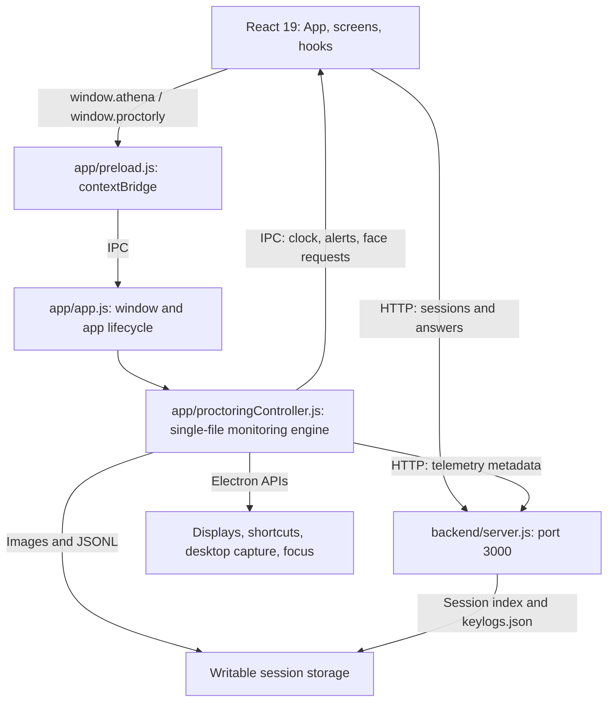
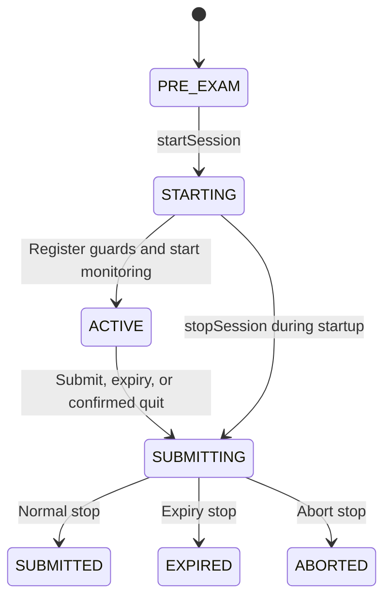
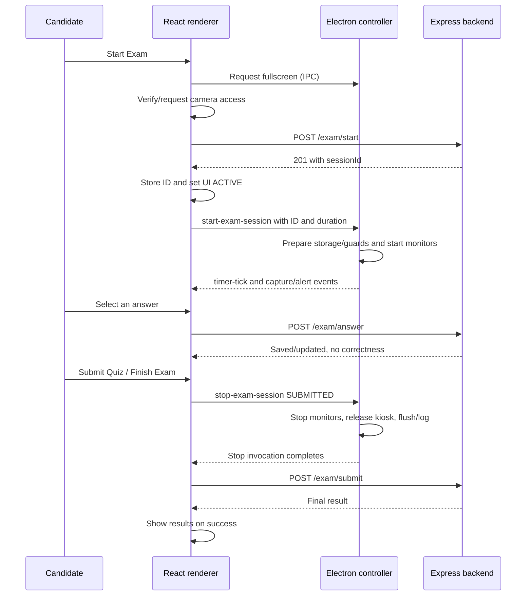
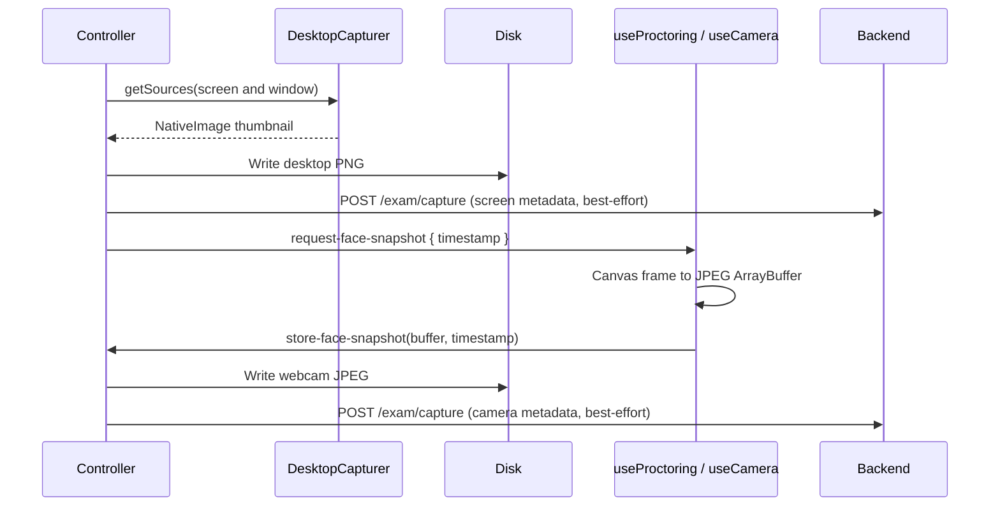

# Proctorly — System Documentation

**Technical overview, developer onboarding and implementation reference**  
Last reviewed: November 25, 2026 · Project version: `0.0.0`

This guide explains what Proctorly does, how its parts communicate, where its data is stored and how to run, inspect and maintain it. It is intended for lecturers evaluating the project and developers joining it for the first time. Basic JavaScript knowledge is helpful; the main React, Electron and backend concepts are explained below.

The descriptions refer to the current repository implementation, including the single-file proctoring controller and extracted frontend screens/hooks. Function names are used instead of fixed line numbers. Examples use fictional candidates and illustrative session IDs.

> **Scope:** Proctorly is a local examination and monitoring application. It records activity for review and applies available desktop restrictions; it does not prove that a candidate has or has not cheated. Native enforcement and evidence collection depend on the operating system, permissions and running processes. The browser preview is not equivalent to the Electron application.

## Contents

- [Project overview](#project-overview)
- [Technology and terminology](#technology-and-terminology)
- [Architecture](#architecture)
- [Repository structure](#repository-structure)
- [Getting started](#getting-started)
- [Candidate experience and scoring](#candidate-experience-and-scoring)
- [Frontend file map](#frontend-file-map)
- [Controller function map](#controller-function-map)
- [Session lifecycle](#session-lifecycle)
- [Restrictions and violation handling](#restrictions-and-violation-handling)
- [Capture and evidence storage](#capture-and-evidence-storage)
- [Timers and keystrokes](#timers-and-keystrokes)
- [IPC and backend contracts](#ipc-and-backend-contracts)
- [Security and privacy](#security-and-privacy)
- [Debugging and validation](#debugging-and-validation)
- [Preserved limitations](#preserved-limitations)
- [Maintenance and further reading](#maintenance-and-further-reading)

### Recommended reading paths

- **Lecturers and evaluators:** Read the project overview, architecture, candidate experience, lifecycle and security/limitations sections. These explain the implemented features and their boundaries.
- **New developers:** Start with getting started and the repository map, then follow one session through the frontend, IPC, controller and backend. Use the debugging section for validation.
- **Returning contributors:** Use the function maps, timing table and contract tables as references before changing behavior.

## Project overview

Proctorly combines an MCQ examination interface with a desktop monitoring layer and a local API. The current assessment contains five questions and uses a 30-minute duration. Candidates enter their name and student ID, enable their camera, complete the readiness flow and answer questions. Answers are saved as they are selected; correctness is calculated only when the session is submitted or expired.

During an Electron exam, the application attempts to keep its window in the foreground, intercept selected shortcuts, detect display changes, capture desktop/webcam images and record activity with timestamps and question IDs. Session records and evidence are written to local files rather than a database.

| Capability | Current implementation | Important boundary |
|---|---|---|
| Candidate setup | Name/ID entry, camera preview, fullscreen test and blocked-app panel | Name/ID are self-entered; there is no identity authentication |
| Examination | Five MCQs, previous/next/direct navigation, answer changes, clearing and review marks | Question count and several UI labels assume five |
| Answer persistence | HTTP requests on selection and clearing, with optimistic UI rollback on failure | No offline answer queue or automatic retry |
| Results | Attempted, correct, incorrect and score percentage | Flags do not change scores or automatically disqualify candidates |
| Desktop restrictions | Electron kiosk, window priority, focus reclaim and shortcut guards | Best-effort OS behavior, not complete control of the computer |
| Environment checks | Initial/manual app checks, display checks at start and on display addition | Apps are not scanned continuously; extra displays are flagged, not rejected |
| Evidence | Periodic desktop PNGs/webcam JPEGs and immediate desktop captures for certain incidents | Local image writes and backend metadata are separate operations |
| Activity logging | Events, key batches, review/answer activity and camera-disconnection telemetry | A flag records an observation, not a verified misconduct finding |

There is no examiner dashboard, user-management system, database, automated face recognition, continuous video recording or AI-based cheating analysis in the current active flow. Evidence inspection is through local files and API records.

## Technology and terminology

### Main technologies

The dependency manifests, [`package.json`](../package.json) and [`backend/package.json`](../backend/package.json), are the source of truth for version ranges. Lockfiles record the resolved installation.

| Technology | Role in Proctorly |
|---|---|
| React 19 | Renders screens and holds candidate/session UI state |
| Vite 8 | Serves the frontend during development and builds it into `dist/` |
| Electron | Runs the desktop application, creates the native window and provides OS APIs |
| Node.js | Executes the backend and supplies filesystem/process APIs to the main process |
| Express 5 and CORS middleware | Provide JSON HTTP routes for sessions, answers, results and telemetry |
| Tailwind CSS 4, existing CSS and Lucide React | Supply styling and interface icons |
| electron-builder | Packages the built application; the configured distribution target is macOS DMG |
| Node test runner, Acorn and Acorn JSX | Support the existing mocked regression and frontend syntax checks |

### Terms used in this guide

| Term | Meaning |
|---|---|
| Renderer | The web-page side of Electron, running the React interface; also the UI shown in browser preview |
| Main process | Electron's desktop-side process, which owns the native window and monitoring controller |
| Preload / context bridge | A script that exposes selected main-process operations to the renderer without enabling general Node access |
| IPC | Inter-process communication: named requests/events between renderer and Electron main process |
| Hook | A React function that groups state, effects and related actions; here hooks keep behavior separate from markup |
| Session | One exam attempt, identified by a `sessionId` shared across answers, logs and evidence |
| Kiosk mode | A native window mode used to limit ordinary window/application interactions |
| Flag / telemetry | A recorded activity observation and its context; not necessarily a security violation |
| Capture metadata | The filename, timestamp, type, path and question context of an image, not the image bytes |
| JSONL | JSON Lines: one JSON record per line, used by append-only event and key logs |

## Architecture

The renderer handles the candidate interface. Electron owns native monitoring. A local Express backend stores sessions and scores answers.



### Responsibilities and communication

| Layer | Owns | Communicates through |
|---|---|---|
| React renderer | Candidate input, screen selection, quiz interactions, camera stream and visible timer/alerts | HTTP to the backend; named preload methods in Electron |
| Preload bridge | A fixed set of invokers and event-listener wrappers | `ipcRenderer.invoke()` and `ipcRenderer.on()` |
| Electron main | Window/app lifecycle, quit confirmation, backend startup and IPC dispatch | Electron APIs, controller calls and a forked backend process |
| Proctoring controller | Local exam state, timing, restrictions, native evidence and telemetry | Electron/Node APIs, renderer events and backend HTTP |
| Express backend | Persistent session records, questions, answers, final scoring and metadata | JSON HTTP requests and local filesystem writes |

An answer selection uses **HTTP**, because it updates the backend's exam record. A fullscreen request uses **IPC**, because only Electron's main process can change the native window. A webcam frame crosses IPC as an `ArrayBuffer`; the controller writes its bytes locally, then sends only metadata over HTTP.

`app/app.js` creates a frameless kiosk window with `contextIsolation: true`, `nodeIntegration: false`, `webSecurity: true` and renderer DevTools disabled. It denies popups, applies a navigation URL-prefix allowlist, intercepts quit shortcuts and forwards input/window events to the controller. The initial window is kiosk-enabled even before the candidate starts an exam; controller monitoring is governed separately by exam state.

Both `window.athena` and `window.proctorly` are exposed by the preload script. Existing frontend calls use `window.athena`. The bridge restricts access to named operations; it is not general Node.js access or comprehensive payload validation.

### Application startup

1. Electron waits for `app.whenReady()` and chooses development or packaged backend/storage paths.
2. It requests `http://localhost:3000/exam/mcq`. If the fetch resolves, it treats the backend as already running; it does not verify the response status or backend identity.
3. If that request rejects, it forks `backend/server.js`, passing writable `DATA_DIR` and `SESSIONS_PATH` values. Fork startup and window creation are not synchronized with a backend readiness check.
4. It creates the native window, attaches the controller and loads `http://localhost:5173` in development. If Vite is unavailable, it attempts `dist/index.html`; packaged applications load `dist` directly.
5. React mounts `App`, initializes session/camera/app hooks and shows the appropriate screen.
6. On quit, the main process flushes pending keys, unregisters shortcuts, stops the focus watchdog and terminates the backend child **only if it started that child**.

The backend is a separate process, not part of React and not an IPC server. Vite is a development tool and is not needed to serve the packaged frontend.

## Repository structure

This map highlights active code, documentation and generated output; it is not a list of every asset or UI utility.

```text
Proctorly/
├── app/
│   ├── app.js                    Electron entry point and IPC handlers
│   ├── preload.js                Renderer bridge and event subscriptions
│   └── proctoringController.js   Single-file monitoring engine
├── backend/
│   ├── data/questions.json      Question source, including answer keys
│   ├── data/sessions.json       Generated session index (ignored by Git)
│   ├── data/sessions/           Generated development evidence
│   ├── server.js                Express routes and file persistence
│   ├── package.json             Standalone backend commands/dependencies
│   └── README.md                Backend API reference
├── src/
│   ├── main.jsx                 React mounting entry point
│   ├── App.jsx                  Screen selection
│   ├── App.css                  Existing shared screen styles
│   ├── index.css                Global styles and Tailwind setup
│   ├── screens/                 Setup, blocked apps, exam and results
│   ├── hooks/                   Shared session, camera, app and IPC behavior
│   ├── services/examApi.js       Session start/fetch HTTP helpers
│   ├── utils/fullscreen.js      Electron/browser fullscreen helpers
│   └── components/Quiz/         Quiz implementation and Quiz.css
├── tests/                       Backend, controller and frontend checks
├── docs/                        This guide and historical project notes
├── build/                       App and DMG icon assets
├── dist/                        Generated Vite frontend build
├── release/                     Generated packaged application/installer
├── index.html                   Frontend HTML entry
├── vite.config.js               Plugins, aliases, watch rules and proxy
├── eslint.config.js             Lint configuration
├── package.json                 Root commands and packaging configuration
└── package-lock.json            Root resolved dependency tree
```

Production evidence is stored outside this repository under Electron's writable `userData` directory. See [Capture and evidence storage](#capture-and-evidence-storage).

## Getting started

### Prerequisites

- Use Node.js **22.12 or later in a compatible supported release** for the current Vite toolchain, and npm. Check with `node --version` and `npm --version`.
- Use macOS for the configured DMG build and the project's macOS-specific window behavior. Windows/Linux branches exist for process enumeration and native fullscreen, but their presence is not a claim of verified platform compatibility.
- Connect a webcam and permit camera access. Native desktop capture also requires the OS permissions applicable to the app/runtime.
- Keep the project and `node_modules` on readable local storage. Cloud-offloaded Desktop/Documents files can cause `ETIMEDOUT` during Vite, lint or build reads.
- Use disposable candidate data for development: captures may include other windows and private desktop content.

### Install dependencies

From the repository root:

```bash
npm ci
npm --prefix backend ci
```

`npm ci` installs from the existing lockfile and replaces that directory's `node_modules`; it does not upgrade dependency versions. Do not delete lockfiles to resolve file-read timeouts. If installation reports a manifest/lockfile mismatch, investigate it as a dependency change rather than silently regenerating versions.

### Run the Electron application

Open two terminals at the repository root.

**Terminal 1 — frontend:**

```bash
npm run dev
```

Confirm Vite is serving port **5173**, because Electron loads that specific address. If Vite selects another port because 5173 is occupied, the desktop app will not automatically follow it.

**Terminal 2 — desktop application:**

```bash
npm start
```

Electron starts/reuses the backend on port 3000 as described in the startup section. For visible backend logs while debugging, optionally start it yourself in a third terminal with `npm --prefix backend start` before launching Electron. An Electron-forked backend has stdout/stderr ignored by the current fork options.

### Run a browser-only preview

Start the backend and frontend in separate terminals:

```bash
npm --prefix backend start
```

```bash
npm run dev
```

Open Vite's displayed URL in a browser. A preview supports candidate entry, camera access, question/answer HTTP requests and browser fullscreen, but has no Electron bridge, process scan, native shortcut interception or desktop evidence. Browser expiry also does not finalize the backend session. Use the preview for UI work, not native proctoring validation.

### Ports and configuration

| Setting | Current value / location |
|---|---|
| Vite frontend | `http://localhost:5173`; expected by `app/app.js` |
| Backend | Port `3000` in `backend/server.js` |
| UI HTTP address | `http://localhost:3000` in `examApi.js` and `Quiz.jsx` |
| Controller HTTP address | `this.backendUrl` in `ProctoringController` |
| Vite `/exam` proxy | Forwards relative `/exam` requests to port 3000; current UI requests are absolute and bypass it |
| Standalone backend data root | `DATA_DIR`, otherwise `backend/data` |
| Standalone session index | `SESSIONS_PATH`, otherwise `<dataDir>/sessions.json` |
| Question source | Always `backend/data/questions.json` relative to the backend script, not `DATA_DIR` |

The frontend's environment settings are not centralized in an `.env` configuration. Backend environment overrides do not redirect controller evidence storage; Electron chooses that location independently. When using a separately started backend, keep its data paths consistent with the controller to avoid split records/evidence.

### Permissions and first-run checks

1. Confirm `/exam/mcq` returns five question objects and the camera preview shows live video.
2. On macOS, check **System Settings → Privacy & Security → Camera** and **Screen Recording / Screen & System Audio Recording**, as named by your OS version. Permission may apply to Electron, the packaged app or the development launcher.
3. Respond to any System Events/Automation permission prompt used by the macOS app scan. A failed scan currently returns empty lists; an empty panel alone is not proof of successful enumeration.
4. Start a disposable exam and inspect actual desktop/webcam files. The setup screen's static green readiness labels are not a complete permissions test.
5. Use Cmd/Ctrl+Q for the app's quit-confirmation path. During an active attempt, confirmed quit locally aborts monitoring.

### Build and package

```bash
npm run vite:build
```

This creates `dist/`. To build the frontend and package the configured application:

```bash
npm run build
```

The root script runs Vite followed by electron-builder. Output goes to `release/`; macOS/DMG branding uses `build/icon.icns`. Packaging unpacks the backend into `app.asar.unpacked/backend`, so Electron can fork it, and excludes per-session evidence directories. The configuration sets macOS signing identity to `null` and has no notarization workflow; do not describe the output as signed/notarized.

Before distribution, inspect the entire packaged backend data tree. Per-session exclusion does not explicitly exclude `backend/data/sessions.json`, and ignored Git files are not automatically absent from a locally produced package. Never ship test or candidate records accidentally.

## Candidate experience and scoring

### Screen flow

1. **Environment verification:** In Electron, an initial process check may display the blocked-app panel. The candidate closes listed apps and selects recheck; there is no app-killing operation.
2. **Setup:** The candidate enters name/student ID, views the camera preview and can test fullscreen. Start-button readiness checks the two text fields; the start handler separately requires camera access.
3. **Active exam:** The screen displays the timer, quiz, question navigation and violation notices. A hidden video element supplies webcam frames for Electron evidence capture; the setup preview is not continuously displayed on the exam screen.
4. **Temporary lock:** Focus/fullscreen events can show an overlay and restrict answering/navigation/submission. The recovery action requests fullscreen and clears the UI lock; successful native recovery still needs verification.
5. **Results:** Submission or expiry selects the results screen. Score details appear when `examResults` is available. Starting a new session resets the candidate/session UI; it does not delete earlier evidence or implement exam resumption.

### Questions, answers and review status

The backend reads the first five entries from `questions.json` and sends only `id`, `question` and `options` to candidates. `correctAnswer` is a **zero-based option index** retained on the backend. The quiz also caps the response at five and contains fixed five-question labels/navigation bounds; reducing the dataset is not a supported way to configure a shorter exam.

Selecting an option immediately updates the React answer map and posts `/exam/answer`. Re-selection updates the existing answer rather than adding a duplicate. On a rejected/failed request, the UI restores the previous local value. Clearing follows the same optimistic-update/rollback pattern using `/exam/clear-answer`.

| Quiz state | Meaning |
|---|---|
| `NOT_VISITED` | The candidate has not opened the question |
| `VIEWED` | Opened, but not answered or marked |
| `ATTEMPTED` | An option is selected |
| `MARKED_FOR_REVIEW` | Marked without an answer |
| `ATTEMPTED_AND_MARKED` | Answered and marked |
| `CURRENT` | Currently displayed; takes priority in the calculated status |

Navigation uses button styling plus a separate review dot. Viewed/review sets live in React memory. Mark/unmark actions also create telemetry through IPC, but the backend does not reconstruct those sets for a resumed quiz. `Quiz` accepts `restoredAnswers`, yet the current screen does not implement a restoration flow.

### Score calculation

On `/exam/submit` or `/exam/expire`, the backend compares each saved option index with the question's `correctAnswer`, stores `isCorrect` on graded answers and returns:

```text
attempted  = number of saved answer records
correct    = saved answers matching the answer key
wrong      = saved answers not matching the answer key
total      = number of questions returned by the capped dataset (normally 5)
percentage = round(correct / total × 100)
```

An unanswered question is neither correct nor wrong. With four attempted questions, three correct and one wrong in the five-question assessment, the result is **60%**. Review marks, keylogs and flags have no effect on this calculation. The active answer-saving response deliberately withholds correctness.

## Frontend file map

All screens keep using the existing `src/App.css`; quiz implementation and its CSS are unchanged.

| File | Responsibility |
|---|---|
| [`src/App.jsx`](../src/App.jsx) | Selects blocked apps, results, active exam, then setup, in that order |
| [`src/screens/SetupScreen.jsx`](../src/screens/SetupScreen.jsx) | Candidate details, camera verification, fullscreen test and start action |
| [`src/screens/BlockedAppsScreen.jsx`](../src/screens/BlockedAppsScreen.jsx) | Blocked-process list and recheck action |
| [`src/screens/ExamScreen.jsx`](../src/screens/ExamScreen.jsx) | Active-exam HUD, hidden capture video, alerts and quiz integration |
| [`src/screens/ResultsScreen.jsx`](../src/screens/ResultsScreen.jsx) | Submission/expiry results and new-exam reset |
| [`src/hooks/useExamSession.js`](../src/hooks/useExamSession.js) | Shared candidate/session state, start, finish, reset and recovery actions |
| [`src/hooks/useCamera.js`](../src/hooks/useCamera.js) | Permissions, stream/video refs, disconnect handler and `storeFaceFrame()` |
| [`src/hooks/useBackgroundApps.js`](../src/hooks/useBackgroundApps.js) | Initial blocked-app check and manual recheck |
| [`src/hooks/useProctoring.js`](../src/hooks/useProctoring.js) | Electron subscriptions, browser fallback timer/fullscreen and DOM input guards |
| [`src/utils/fullscreen.js`](../src/utils/fullscreen.js) | Electron detection and cross-browser fullscreen entry, exit and detection |
| [`src/services/examApi.js`](../src/services/examApi.js) | Session start and session fetch requests |
| [`src/components/Quiz/Quiz.jsx`](../src/components/Quiz/Quiz.jsx) | Questions, answer saving/clearing, navigation and submission |

The parent hook owns shared state so switching screens does not reset candidate details, the camera stream, timers or alert state. Extracted screens receive this state through props.

### State ownership

| State / reference | Owner and purpose |
|---|---|
| `studentName`, `studentId` | `useExamSession`: candidate input used in session creation |
| `sessionId`, `sessionIdRef` | `useExamSession`: render state plus a mutable reference for asynchronous listeners |
| `examState`, `examResults` | `useExamSession`: selected lifecycle screen and available score details |
| `timerDisplay` | `useExamSession`, updated by `useProctoring`: formatted visible countdown |
| `examLocked`, `fullscreenViolation`, `focusLostAlert`, `blockedKeyAlert` | Shared UI restrictions and notices, updated by actions/listeners |
| `isFullscreenActive` | Shared fullscreen status used by setup/recovery controls |
| `cameraEnabled`, `cameraError`, `videoRef`, `streamRef` | `useCamera`: permission/stream status and video attachment |
| `blockedAppsList`, `showAppsPanel` | `useBackgroundApps`: initial/manual scan output and panel visibility |
| Questions, answer map, current index, review/viewed sets, submission guard | `Quiz`: assessment-local state |

`App.jsx` selects screens in this order: **blocked apps → submitted/expired results → active exam → setup**. Preserve that priority when editing the selector.

`useProctoring` registers Electron event handlers and removes them when its effect is cleaned up. It also owns browser-only fullscreen events/countdown and active DOM copy/paste/context-menu guards. Electron subscriptions intentionally retain the original `[examState]` effect lifetime, including a captured fullscreen-violation value; changing this is a behavioral correction, not merely moving code.

`examApi.js` centralizes only session-start/session-fetch requests. Quiz requests remain in `Quiz.jsx`; do not assume every backend call passes through the service helper.

## Controller function map

Every controller method and helper stays in [`app/proctoringController.js`](../app/proctoringController.js). No new controller modules or production dependencies were introduced.

| Area | Methods / constants |
|---|---|
| Session state | `EXAM_STATES`, `getState()`, `getSession()`, `setCurrentQuestionId()`, `startSession()`, `stopSession()` |
| Safe window operations | `hasWindow()`, `safeSend()`, `pinWindow()`, `focusWindow()` |
| Lockdown | `enterExamFullscreen()`, `exitExamFullscreen()`, `reclaimFocus()` |
| Display checks | `checkDisplays()`, `initDisplayMonitoring()` |
| Processes | `BLOCKED_APPS`, `getRunningProcesses()` |
| Timer plumbing | `clearTimer()`, `scheduleActiveInterval()` |
| Capture scheduling | `startCaptureScheduler()`, `stopCaptureScheduler()`, `triggerSynchronizedCapture()` |
| Image storage | `captureDesktop()`, `saveFaceSnapshot()`, `saveCapture()`, `captureImmediate()` |
| Storage paths | `getTimestamp()`, `getSessionDir()`, `ensureSessionDirs()` |
| Clock | `startClockTimer()`, `stopClockTimer()`, `handleExamExpired()` |
| Shortcut blocking | `GLOBAL_SHORTCUTS`, blocked-key sets, `isBlockedInput()`, `handleInputEvent()`, `registerGlobalShortcuts()`, `unregisterGlobalShortcuts()` |
| Focus watchdog | `startKioskEnforcement()`, `stopKioskEnforcement()` |
| Window events | Focus/fullscreen handlers, `recordWindowViolation()`, `notifyWindowRestored()` |
| Keystrokes | `recordKeylog()`, `flushKeylogs()` |
| Logs and backend | `appendSessionLog()`, `logEvent()`, `flagBackend()`, `postBackend()` |

Shared helpers remove repeated operations, not security decisions. Keep behavior-specific ordering in the public methods. `postBackend()` returns the fetch promise without interpreting HTTP status codes; each caller keeps its existing error policy.

### Controller organization

The constructor initializes `PRE_EXAM`, current question ID `1`, a 10-second capture interval, timer handles, an in-memory key buffer and the backend URL. `setWindow()` attaches the native window and display listener; `setCurrentQuestionId()` accepts a positive numeric ID for subsequent evidence attribution.

Lifecycle methods coordinate the helpers rather than hiding policy inside them. For example, the violation helper posts a flag before awaiting a screenshot, and stopping monitors precedes releasing kiosk mode. These ordering choices matter for debugging asynchronous events.

The controller's session object is **in-memory main-process metadata**, not the backend's persistent record. `getSession()` returns that local object. `getSessionDir()` independently chooses evidence storage; `safeSend()` guards against destroyed native objects but does not queue missed renderer events or wait for the page to finish loading.

## Session lifecycle



`READY` remains an exported constant but the controller does not transition into it. Backend status strings are separate: `in-progress`, `submitted`, and `expired`. Controller states use uppercase strings.

1. `useExamSession.handleStartExam()` validates trimmed candidate details, requests fullscreen before awaiting camera/network work, and posts `/exam/start`.
2. The renderer stores the session ID and marks its UI active before invoking `start-exam-session` over IPC.
3. `startSession()` creates local metadata and directories, flags multiple displays, enters kiosk mode for `PROCTORED`, shows/focuses the window, registers shortcuts, and starts the watchdog. It then sets `ACTIVE` and starts clock/capture timers.
4. Quiz submission **first** stops local monitoring through IPC, then requests grading through `/exam/submit`. Only a successful grading response invokes the renderer's finish action.
5. Expiration sends `exam-expired` to the renderer **before** awaiting `/exam/expire`, then calls `stopSession(EXPIRED, ...)`.
6. `stopSession()` sets `SUBMITTING`, stops recurring monitors, unregisters shortcuts, releases kiosk mode, flushes keys, appends an end event, updates local session metadata, and sends `exam-state-changed`.

`stopSession()` itself does not finalize the backend. Confirmed quit locally aborts monitoring; it does not add a backend abort endpoint.

### Three distinct state models

| Layer | States used | Persistence |
|---|---|---|
| React UI | Primarily `PRE_EXAM`, `ACTIVE`, `SUBMITTED`, `EXPIRED` | Memory; resets on page reload |
| Controller | `PRE_EXAM`, `STARTING`, `ACTIVE`, `SUBMITTING`, final `SUBMITTED`/`EXPIRED`/`ABORTED`; `READY` is exported but unused | Memory; includes local timestamps and duration |
| Backend | `in-progress`, `submitted`, `expired` | `sessions.json`; no abort status endpoint |

An IPC stop changes controller state, whereas an HTTP submit/expire changes backend status. Neither guarantees the other changed. Do not diagnose a session using only the results screen or only one of these records.

### Start and submission sequence



The fullscreen call begins before waiting on camera/network work to retain the initiating browser gesture. The renderer then awaits it, but does not enforce its boolean success result before setting the fullscreen UI state. A main-process start failure can also occur after backend creation and UI activation; there is no transactional rollback across all three layers.

### Expiry, quit and reload behavior

- **Electron expiry:** The clock reaches zero, sends `exam-expired`, awaits `/exam/expire` and then stops locally as `EXPIRED`. React fetches session details on the event rather than using the expire response. That fetch can happen before grading finishes; repeated expiry callbacks are possible while the request is pending.
- **Browser expiry:** A React interval decrements 1800 seconds and switches the UI to `EXPIRED`. It neither posts `/exam/expire` nor collects native evidence.
- **Confirmed quit:** Cmd/Ctrl+Q or a native close attempt opens confirmation. An active exam stops locally as `ABORTED`; the backend may remain `in-progress`.
- **Renderer reload:** On initial renderer load, `useExamSession` checks main state and aborts an existing active controller session with reason `Initial load sync reset`. This is reset behavior, not crash recovery or exam resumption.
- **Renderer process gone:** The main-process handler stops recurring clock/capture/watchdog timers. It does not reload the renderer, finalize the backend or perform a complete session stop.

Because local stop precedes backend submit, a failed submit can leave the quiz visible while native monitoring has already stopped. This is an existing failure policy requiring a separately agreed behavioral fix.

## Restrictions and violation handling

### Window and display enforcement

- `pinWindow()` makes the window visible on all macOS workspaces and sets screen-saver-level priority. Other platforms skip workspace pinning.
- `enterExamFullscreen()` enables kiosk mode and brings the app forward. Non-macOS platforms also enter native fullscreen; macOS avoids creating an isolated fullscreen Space.
- `reclaimFocus()` restores priority and invokes `app.focus({ steal: true })`, then window focus. It does not independently re-enable kiosk mode.
- `checkDisplays()` reports count/bounds/primary display. Multiple displays are flagged, not rejected by `startSession()`.
- A `display-added` event during `ACTIVE` flags the connection, requests immediate capture, sends the display count to the UI and reclaims focus. The listener is attached by `setWindow()`.
- Clipboard clearing remains in `app/app.js` every 2 seconds during `ACTIVE`, not inside the blur handler.

### Focus and fullscreen events

`handleFocusLost()` reclaims focus immediately for proctored sessions, before asynchronous capture work. The shared violation helper preserves this sequence:

```text
append event -> post flag (not awaited) -> await immediate screenshot
            -> flush pending keys -> notify UI
```

The fullscreen-exit handler ignores events while the window still reports kiosk or fullscreen mode. Restored handlers append restoration events and notify the renderer. The UI controls quiz locking and recovery.

### Keyboard and process checks

`isBlockedInput()` checks explicit key sets and modifier rules: Cmd/Ctrl combinations, Cmd/Ctrl+Shift inspection keys, Cmd/Ctrl+Alt+Escape, Alt+Tab/F4, and unmodified system keys. It does **not** perform exact modifier equality for every rule. Global shortcut registration is best-effort because some combinations are reserved by the OS. Cmd/Ctrl+Q remains handled by `app/app.js` for quit confirmation.

Process enumeration uses:

- macOS: AppleScript through System Events, listing non-background application processes.
- Windows: `tasklist /FO CSV /NH`.
- Linux: `ps -eo comm --no-headers | sort -u`.

Names are deduplicated, known app/IDE names are ignored, and blocked names use case-insensitive substring matching. Command failure returns empty lists. The frontend checks on initial load and manual recheck; there is no periodic process scanner.

## Capture and evidence storage



Desktop capture precedes the webcam request; the files share a timestamp, but are not physically captured at exactly the same instant. Thumbnails are capped at 1920×1080 using the primary display's size and scale. If screen capture throws or yields no bytes, the controller tries `webContents.capturePage()`; if there is no primary display, the existing early return skips that fallback.

`saveCapture()` writes bytes **before** posting metadata. Desktop filenames end in `.png`, webcam filenames in `.jpg`. The backend does not receive image bytes or serve a capture directory.

```text
Development: backend/data/
Packaged:    <Electron userData>/data/
  sessions.json
  sessions/<sessionId>/
    screenshots/<timestamp>.png
    camerashots/<timestamp>.jpg
    events.jsonl
    keylogs.jsonl
    keylogs.json
```

Capture metadata keeps the original project-relative `path` calculation, including packaged paths that may contain parent-directory segments. Do not change this contract while doing a readability-only cleanup.

## Timers and keystrokes

| Monitor | Timing / behavior |
|---|---|
| Initial capture | One timeout at 3000 ms; checks only `ACTIVE` |
| Recurring capture | Interval at 10000 ms from scheduler start, then 20000 ms, etc. |
| Main clock | 1000 ms interval; elapsed = `floor((Date.now() - startTime) / 1000)` |
| Kiosk/focus watchdog | 1000 ms interval |
| Normal typing batch | One 250 ms timeout from first buffered ordinary key |
| Suspicious combinations | Immediate keylog flush |
| Clipboard clear | 2000 ms interval in `app/app.js` |
| Blocked-key toast | Cleared after 2500 ms in `useProctoring` |

`scheduleActiveInterval()` centralizes the recurring-monitor guard: inactive state, missing window or destroyed window clears that interval and stops its work. Public stop methods remain available to `app/app.js`.

`recordKeylog()` uses an array buffer, not a ring buffer or worker thread. Key records preserve session ID, ISO timestamp, question ID, event type, combination, modifiers and blocked status. `flushKeylogs()` clears its timeout, copies/empties the buffer, synchronously appends JSONL, then posts `/exam/keylog`. Backend session and `keylogs.json` updates are separate writes.

## IPC and backend contracts

[`app/preload.js`](../app/preload.js) remains the source of truth for invokers and unsubscribe-returning listeners. Main-to-renderer channels include `timer-tick`, `request-face-snapshot`, `blocked-keybinding`, focus/fullscreen events, `exam-expired`, `exam-state-changed`, and `external-display-detected`.

Controller HTTP posts keep their original bodies:

- `/exam/flag`: session ID, type, details, question ID, timestamp.
- `/exam/capture`: session ID, type, filename, timestamp, question ID, relative path.
- `/exam/keylog`: session ID and keylog batch.
- `/exam/expire`: session ID.

The backend serves five questions without answer keys; `/exam/answer` returns only message and attempted count. Submit/expire evaluates correctness and returns attempted, correct, wrong, total and percentage. See [`backend/README.md`](../backend/README.md) for endpoints and examples.

`saveSessions()` tries temp-file write plus rename, then falls back to direct writing. Read/parse failures return an empty session list. This is best-effort local persistence, not ACID storage or guaranteed crash recovery.

## Debugging and validation

Run from the repository root:

```bash
node --test tests/*.test.cjs
node --check app/proctoringController.js
npm run vite:build
npx eslint src/App.jsx src/hooks src/screens src/services src/utils app/proctoringController.js
```

Controller/frontend tests compare against pre-cleanup commit `4eff01d312be4ee7efdd5817063185f2d07479af`; retain that Git history to run them after committing. Controller checks cover public methods/constants, lifecycle and asynchronous ordering, keyboard combinations, clock/capture scheduling, window guards, evidence paths, process commands and failure policies. They mock native APIs, network and file writes. Frontend checks compare JSX structure, screen priority and start/reset/recovery actions, and parse all extracted files using existing Acorn/JSX packages. Backend tests invoke real route handlers with mocked routing and disposable storage, covering answers, scoring, validation and telemetry. These suites do not verify real React lifecycle behavior, visual rendering or live Electron/HTTP integration.

During this cleanup, build and lint could not complete successfully: installed dependency reads timed out (`os error 60` for Lucide modules; `ETIMEDOUT` while loading ESLint rules). These failures prevent a clean build/lint claim. Ensure local dependency files are readable before rerunning; the cleanup does not reinstall or change packages.

### Where to put breakpoints

| Symptom | Start here | Inspect |
|---|---|---|
| Start fails | `useExamSession.handleStartExam()`, controller `startSession()` | Camera result, backend response, session ID, state |
| Window stays locked | `exitExamFullscreen()`, `stopSession()` | Stop order, kiosk/fullscreen flags, destroyed window |
| Quiz will not unlock | `useProctoring` focus/fullscreen listeners | `examLocked`, captured `fullscreenViolation`, recovery action |
| Missing screenshots | `captureDesktop()`, `saveCapture()` | OS screen-recording permission, primary display, thumbnail bytes, write exception |
| Missing camera images | `storeFaceFrame()`, `saveFaceSnapshot()` | Track/video dimensions, blob, timestamp, active state |
| Missing telemetry | `flushKeylogs()`, `flagBackend()`, `postBackend()` | Buffer, JSONL, request payload, backend availability |
| Timer discrepancy | `startClockTimer()`, `useProctoring` timer listener | Wall-clock start, duration, remaining, live window |
| False process match | `getRunningProcesses()` | Raw stdout, ignored names, substring match |

Existing warnings identify kiosk and image-save failures. Network failures while flagging append a `BACKEND_UNAVAILABLE` event. Other best-effort catches intentionally remain silent; pause on caught exceptions to inspect them rather than adding behavior-changing retry/logging logic.

### Manual checks still required

Use a disposable candidate/session, not a real exam:

1. Verify setup, blocked-app list/recheck, fullscreen test and camera permission denial/retry.
2. Start a session; confirm five-question navigation, answer save/update/clear, review flags and unchanged UI.
3. Confirm desktop PNG/webcam JPEG pairs after 3 seconds and recurring capture, plus matching timestamps/metadata.
4. Check native shortcut blocking, quit confirmation, focus recovery and the fullscreen lock/unlock overlay.
5. Connect a second display; confirm the flag/event path and focus reclaim. Disconnect/reconnect the webcam and inspect media-status telemetry.
6. Submit, inspect scoring and kiosk release, then reset and start a fresh session.
7. Exercise expiry and inspect its backend/local states; test the browser-only preview separately.

## Preserved limitations

These were not silently fixed in the cleanup:

- Initial capture timeout is not stored/cancelled; its callback checks active state.
- Electron expiry UI fetch can race backend finalization because notification comes first. Repeated expiry callbacks can occur while the request is pending.
- Browser-only expiry locks the UI but does not finalize the backend or produce desktop evidence.
- Electron alert subscriptions retain their original `[examState]` lifetime and captured fullscreen-violation value.
- The main clock uses wall time; it is not immune to system-clock changes.
- The watchdog reclaims focus/priority but does not itself re-enable kiosk mode.
- Process-scan failure returns empty lists; native reserved shortcuts may not register.
- Backend submit/expire permits re-finalization. Local evidence and network telemetry are best-effort, without an outbox or retry guarantee.

Any correction to these behaviors needs a separate, agreed feature/bug-fix change.
